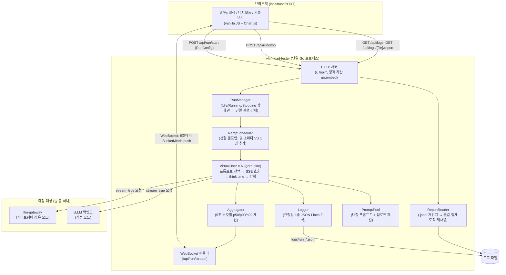
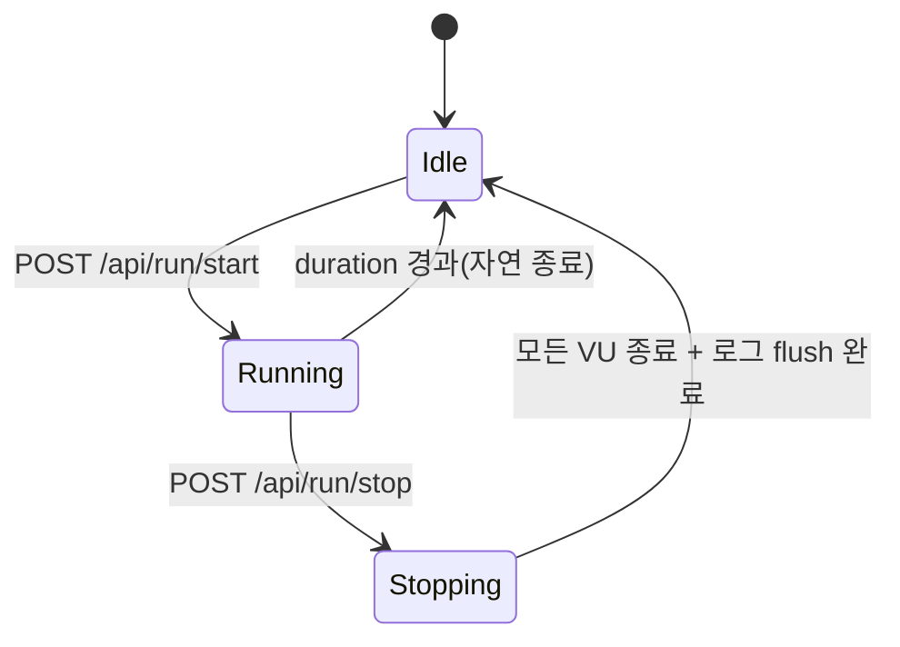
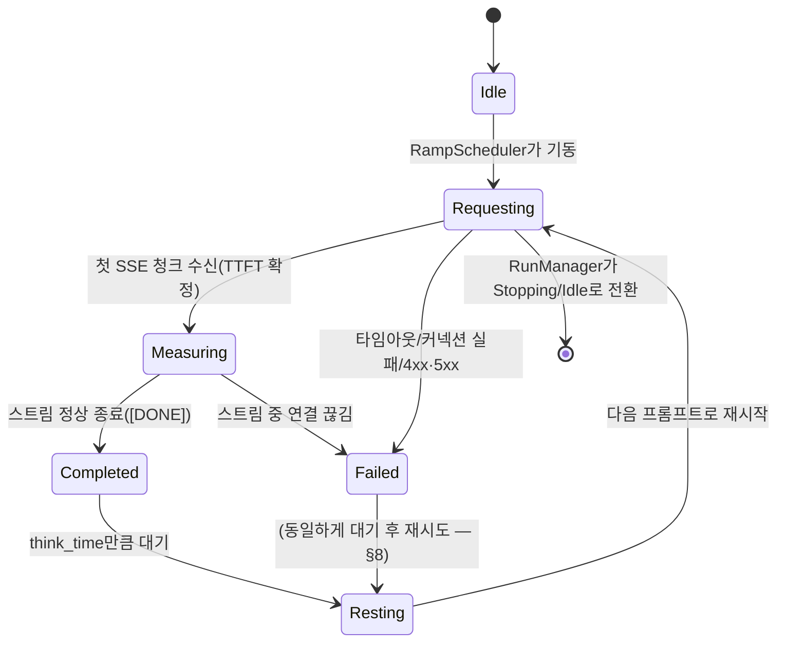
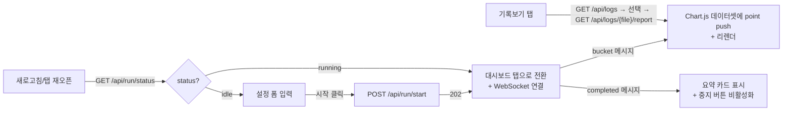

# Brief: vllm-load-tester (prd.md + sdd.md 병합본)

이 문서는 `/simple-e2e:prd-creator`로 작성한 `prd.md`와 `/simple-e2e:system-design`으로
작성한 `sdd.md`를 그대로 이어붙인 것입니다. `ask-harness`의 Planner는 아래 내용을
재설계하지 않고 그대로 `spec.md`에 반영해야 합니다 (아키텍처/API/데이터 모델/보안
설계는 이미 확정된 결정입니다).

---

## Part 1 — PRD (원본: prd.md)

### 1. 프로젝트 개요

| 항목 | 내용 |
|---|---|
| 서비스 이름 | vllm-load-tester |
| 한 줄 설명 | llm-gateway 뒤에 있는 **vLLM 백엔드의 실제 추론 성능**을 측정하기 위해 램프업 부하를 걸어 TTFT/TPOT/ITL이 동시 사용자 수에 따라 어떻게 저하되는지 관찰하는 로컬 GUI 스트레스 테스트 도구 |
| 핵심 가치 | **측정 대상은 vLLM의 추론 성능**이다. 사용자 수를 **점진적으로 늘려가며** 응답 지연이 **정확히 어느 지점부터 나빠지는지**를 실시간으로 보여주고, 그 근거(원시 로그)를 남겨 나중에 다시 분석할 수 있게 한다 |
| 언어/런타임 | Go (최신 안정 버전) — llm-gateway와 동일 언어로 코드/지식 공유 |
| 실행 환경 | 개발자의 macOS 노트북에서 로컬 실행(배포/서버 운영 대상 아님) |

### 2. 타겟 유저 및 사용자 시나리오

- **타겟 유저**: llm-gateway/vLLM을 개발/운영하는 엔지니어 본인. 별도 인증이나 다중 사용자 개념은 없다(로컬 단일 사용자 도구).
- **측정 대상 모드** — 이 도구는 **vLLM 자체의 성능**을 재는 것이 목적이므로, 호출 경로를 두 가지 중 선택할 수 있다:
  1. **게이트웨이 경유** — `llm-gateway`의 `gateway_url` + `bearer_token`으로 호출. 실제 클라이언트가 겪는 경로와 동일하지만, 게이트웨이가 여러 vLLM을 로드밸런싱하고 있다면 관찰되는 저하 지점은 "백엔드 풀 전체의 처리 용량"을 반영한다(개별 vLLM 인스턴스 하나의 순수 성능이 아님). 게이트웨이 자체의 오버헤드(인증/rate limit 체크)는 vLLM 추론 시간에 비해 무시할 만하다고 가정한다.
  2. **vLLM 직접 호출** — 게이트웨이를 거치지 않고 개별 vLLM 백엔드의 URL로 직접 호출(`backend_url`, 인증 불필요할 수 있음). 게이트웨이 오버헤드/로드밸런싱을 완전히 배제하고 **그 vLLM 인스턴스 하나의 순수 성능**만 측정하고 싶을 때 사용한다.
- **핵심 시나리오**:
  1. 엔지니어가 도구를 실행하면 브라우저가 열리고 설정 화면이 뜬다.
  2. 측정 대상 모드(게이트웨이 경유/vLLM 직접)를 고르고, 그에 맞는 URL(및 게이트웨이 모드면 Bearer token), TLS 여부, 동시 사용자 수(예: 300), 지속시간(분), 램프업 방식 등을 입력하고 "시작"을 누른다.
  3. 도구는 0명에서 시작해 지정한 지속시간 동안 선형으로 동시 사용자 수를 목표치까지 늘리며, 각 가상 사용자는 서로 다른 프롬프트로 계속 요청을 보낸다.
  4. 화면에는 실시간으로 "현재 동시 사용자 수 대비 TTFT/TPOT/ITL(p50/p90/p99)" 그래프가 갱신된다 — 엔지니어는 그래프가 꺾이기 시작하는 지점을 보고 "이 vLLM(또는 vLLM 풀)이 몇 명부터 느려지는지" 판단한다.
  5. 테스트가 끝나면 로그 파일(JSON Lines)이 남고, 도구의 "기록 보기" 화면에서 그 로그 파일을 다시 불러와 동일한 그래프를 재현할 수 있다.

### 3. 핵심 기능 명세

#### 필수 기능

1. **테스트 설정 입력 (GUI)** — 다음 항목을 입력받는다:
   - `target_mode` (필수, 라디오) — **게이트웨이 경유** 또는 **vLLM 직접 호출**
   - `target_url` (필수, 예: `http://localhost:8080`(게이트웨이) 또는 `http://localhost:8000`(vLLM 직접)) — 라벨은 모드에 따라 "Gateway URL" / "vLLM Backend URL"로 바뀐다
   - `use_tls` (체크박스) — 켜지면 `https://`로 호출
   - `skip_tls_verify` (체크박스, 기본 OFF) — 자체서명 인증서 허용
   - `bearer_token` (게이트웨이 모드에서만 필수, vLLM 직접 모드에서는 선택) — 게이트웨이가 발급한 클라이언트 API Key. vLLM 직접 모드에서도 입력하면 `Authorization: Bearer` 헤더로 그대로 전달한다(vLLM에 자체 인증이 설정된 경우 대비)
   - `model` (필수, 텍스트 입력) — 요청 body의 `model` 필드
   - `max_tokens` (기본값 256)
   - `target_concurrency` (필수, 예: 300) — 램프업 목표 동시 사용자 수
   - `duration_minutes` (필수) — 전체 테스트 지속시간. 이 시간에 걸쳐 0명→목표치까지 선형 램프업
   - `think_time_min_ms` / `think_time_max_ms` (기본 0~2000ms) — 가상 사용자가 응답을 받은 후 다음 요청 전 대기하는 범위(매 요청마다 이 범위 내 랜덤값)
   - `request_timeout_seconds` (기본 60초)
   - `prompt_source` — "내장 풀 사용"(기본) 또는 "파일 업로드"(.txt: 줄바꿈 구분, 또는 .jsonl: 각 줄 `{"prompt": "..."}`)
   - `log_file_path` (기본값 자동 생성: `logs/run_<timestamp>.jsonl`)
2. **램프업 부하 생성** — `target_concurrency`와 `duration_minutes`로부터 "몇 초마다 가상 사용자를 몇 명씩 추가로 기동할지" 스케줄을 계산해 선형으로 동시 사용자를 늘린다. 목표치에 도달하면 지속시간이 끝날 때까지 그 수준을 유지한다.
3. **가상 사용자(Virtual User) 동작** — 각 가상 사용자는 독립 goroutine으로, 종료 신호를 받을 때까지 다음을 반복한다: (a) 프롬프트 풀/파일에서 프롬프트 1개를 순환 또는 랜덤 선택, (b) `stream=true`로 `/v1/chat/completions` 호출, (c) SSE 청크를 받으며 TTFT/ITL 계산, (d) 완료 후 think time만큼 대기 후 반복.
4. **메트릭 계산** — 요청마다:
   - **TTFT**: 요청 전송 ~ 첫 SSE 청크 수신까지
   - **ITL**: 연속된 두 청크 수신 시각의 차이(청크별 배열)
   - **TPOT**: (마지막 청크 수신 - 첫 청크 수신) / (완성 토큰 수 - 1) — 전체 응답 구간의 평균 토큰당 시간
5. **집계 및 실시간 시각화** — 5초 단위 시간 구간(버킷)마다 그 구간에 완료된 요청들의 TTFT/TPOT/ITL의 p50/p90/p99와 그 구간의 평균 동시 사용자 수·에러율을 계산해, "동시 사용자 수(x축) 대 지연시간(y축)" 그래프를 실시간 갱신한다(WebSocket으로 브라우저에 push).
6. **구조화 로그 기록** — 모든 개별 요청 결과를 `log_file_path`에 요청당 1줄 JSON Lines로 기록(성공/실패 모두, 민감정보인 `bearer_token` 원문은 로그에 남기지 않음).
7. **기록 보기(리포트) 화면** — 과거 로그 파일(.jsonl)을 선택하면 저장된 원시 데이터로부터 동일한 시간대별 p50/p90/p99 그래프와 요약 통계(전체 요청 수, 에러율, 관찰된 최대 동시 사용자 수, "지연시간이 급격히 증가하기 시작한 동시 사용자 수 추정치")를 다시 그려 보여준다.
8. **테스트 중단** — 실행 중 "중지" 버튼으로 즉시 모든 가상 사용자를 정지시키고, 진행 중이던 요청은 `request_timeout_seconds` 내에서 완료되도록 유예한 뒤 로그를 마무리한다.
9. **내장 프롬프트 풀** — 길이/주제가 다양한 프롬프트 수십 개를 도구에 내장해, 파일을 준비하지 않아도 바로 테스트할 수 있게 한다.

#### 향후 확장 (이번 범위 아님)

- 다중 모델/다중 엔드포인트 동시 비교 테스트
- 결과 리포트 PDF/CSV 내보내기
- CI 연동(회귀 성능 테스트 자동화)
- 여러 노트북에서 분산 부하 생성(현재는 단일 macOS 노트북 로컬 실행 전제)

### 4. 기술 스택

| 영역 | 선택 | 근거 |
|---|---|---|
| 언어 | Go (최신 안정 버전) | llm-gateway와 동일 스택으로 코드/노하우 공유. 수백 개의 동시 SSE 연결을 goroutine으로 가볍게 처리 가능(스레드 기반 GUI 프레임워크 대비 오버헤드가 훨씬 낮아 "측정 대상이 아닌 도구 자체의 부하"를 최소화) |
| GUI 방식 | 로컬 웹 UI — Go `net/http` 서버가 정적 HTML/JS를 서빙하고, 실행 시 기본 브라우저를 자동으로 열어줌 | 네이티브 GUI 툴킷(빌드 서명/배포 복잡도) 없이 macOS에서 바로 실행 가능한 단일 바이너리. Wails 같은 네이티브 래퍼보다 빌드가 단순 |
| 실시간 갱신 | WebSocket (`gorilla/websocket` 또는 표준 라이브러리 기반 경량 구현) | 진행 중인 테스트의 집계 지표를 프론트엔드로 push |
| 차트 | Chart.js (CDN 없이 로컬 번들, 오프라인 사용 가능하게 vendoring) | 시계열 다중 라인(p50/p90/p99) 표현에 적합, 가볍고 실시간 갱신 지원 |
| HTTP 클라이언트 | Go 표준 `net/http` + `bufio.Scanner`로 SSE 파싱 | llm-gateway의 프록시 구현과 동일한 패턴 재사용 가능 |
| 로그 포맷 | JSON Lines (`logs/run_<timestamp>.jsonl`) | llm-gateway 자체 로그 포맷과 일관, 스트리밍 쓰기/읽기 용이 |
| 빌드/배포 | Makefile로 macOS(darwin/amd64, darwin/arm64) 단일 바이너리 빌드 | 노트북에서 바로 실행할 단일 실행파일이면 충분, Docker/서버 배포 불필요 |

### 5. 주요 화면 구성 및 User Flow

#### 화면 1 — 테스트 설정

```
┌─────────────────────────────────────────┐
│ vLLM Load Tester                         │
├─────────────────────────────────────────┤
│ 측정 대상  ( ● 게이트웨이 경유 ) ( ○ vLLM 직접 )│
│ Gateway URL      [ http://localhost:8080]│
│ ☐ Use TLS   ☐ Skip TLS verify            │
│ Bearer Token     [ ****************** ]  │
│ Model            [ mlx-community/...   ] │
│ Max Tokens       [ 256 ]                 │
│ Target Concurrency [ 300 ]               │
│ Duration (min)   [ 10 ]                  │
│ Think time (ms)  [ 0 ] ~ [ 2000 ]        │
│ Request timeout  [ 60 ] sec              │
│ Prompt source    ( 내장 풀 ) ( 파일 업로드 )│
│                                           │
│        [  ▶ 테스트 시작  ]                │
└─────────────────────────────────────────┘
```

#### 화면 2 — 실시간 대시보드 (테스트 진행 중)

```
┌─────────────────────────────────────────┐
│ 진행 시간: 03:24 / 10:00   현재 동시사용자: 102/300│
│ 누적 요청: 1,204   에러율: 0.3%           │
├─────────────────────────────────────────┤
│  [ TTFT p50/p90/p99 vs 시간/동시사용자 ]  │
│  [ TPOT p50/p90/p99 vs 시간/동시사용자 ]  │
│  [ ITL  p50/p90/p99 vs 시간/동시사용자 ]  │
├─────────────────────────────────────────┤
│           [ ■ 중지 ]                     │
└─────────────────────────────────────────┘
```

#### 화면 3 — 기록 보기 (리포트)

```
┌─────────────────────────────────────────┐
│ 로그 파일 선택: [ logs/run_20260910_1400.jsonl ▾ ] │
├─────────────────────────────────────────┤
│  (화면 2와 동일한 3개 그래프, 저장된 데이터로 재생성) │
│  요약: 총 요청 5,412 / 에러율 1.1% /      │
│        지연 급증 추정 지점: 약 210명       │
└─────────────────────────────────────────┘
```

#### User Flow

```
설정 입력 → [테스트 시작] → 램프업 시작(0→목표 동시사용자, 선형)
   → 각 가상 사용자: 프롬프트 선택 → SSE 호출 → TTFT/ITL/TPOT 계산 → think time → 반복
   → 5초 버킷마다 p50/p90/p99 집계 → WebSocket push → 대시보드 갱신
   → duration 종료 또는 [중지] → 진행 중 요청 유예 종료 → 로그 파일 완결
   → (언제든) 기록 보기 화면에서 과거 로그 선택 → 동일 그래프 재생성
```

### 6. 상세 기능 명세 및 예외 처리 정책

- **입력 검증**: `target_url` 미입력/형식 오류, `target_concurrency` ≤ 0, `duration_minutes` ≤ 0, (게이트웨이 모드일 때) `bearer_token` 미입력 시 "테스트 시작" 버튼을 비활성화하고 필드 옆에 인라인 에러 메시지를 표시한다(서버까지 요청을 보내지 않음). vLLM 직접 모드에서는 `bearer_token`이 비어 있어도 정상 진행된다.
- **개별 요청 실패 처리** — HTTP 에러(401/429/503 등)나 타임아웃, 커넥션 거부는 해당 가상 사용자의 사이클을 실패로 로그에 기록(status, error_type)하고, 그 가상 사용자는 think time 후 다음 요청을 계속 시도한다(한 번 실패했다고 그 가상 사용자를 영구 종료하지 않음 — 실제 부하 패턴을 유지하기 위함).
- **429(Rate limit) 대량 발생 시** (게이트웨이 경유 모드) — 대시보드 상단에 경고 배너("에러율 N% — llm-gateway의 rate limit에 걸리고 있을 수 있습니다. vLLM 자체 저하가 아닐 수 있으니 vLLM 직접 모드로 재확인해보세요")를 표시한다. 테스트를 자동 중단하지는 않는다(그 자체가 관찰하려는 현상일 수 있으므로).
- **SSE 파싱 실패/중간 연결 끊김**: 해당 요청은 실패로 기록하되, 이미 수신한 청크까지의 ITL은 로그에 남긴다(부분 데이터도 분석 가치가 있음).
- **테스트 도중 브라우저 탭을 닫아도** 백엔드(Go 프로세스)의 부하 생성은 계속되고 로그도 계속 쌓인다 — 새로고침하거나 다시 열면 WebSocket이 재연결되어 진행 중인 테스트 상태를 이어서 보여준다.
- **로그 파일에 절대 남기지 않는 것**: `bearer_token` 원문. 로그에는 토큰의 마스킹된 마지막 4자리(`****abcd`)만 남긴다.
- **동시 실행 방지**: 이미 테스트가 진행 중인 상태에서 "테스트 시작"을 다시 누르면 무시하고 안내만 표시한다(한 번에 하나의 테스트만 허용).

### 7. UI/UX 디자인 가이드

- **단일 페이지 앱(SPA)에 가까운 3-탭 구조**: 설정 / 실시간 대시보드 / 기록 보기. 테스트가 시작되면 자동으로 대시보드 탭으로 전환된다.
- **색상**: 지연시간 그래프에서 p50은 안정적인 색(예: 파랑), p90은 경고성 색(주황), p99는 위험성 색(빨강)으로 구분해 "꼬리 지연"이 한눈에 보이게 한다.
- **반응형은 필요 없음** — 로컬 개발용 도구이므로 데스크톱 브라우저 창 크기 기준으로만 설계한다(모바일 대응 불필요).
- **입력 항목은 접었다 펼 수 있는 "고급 설정" 섹션으로 분리**: 기본(Gateway URL/Token/동시사용자/지속시간)은 항상 보이고, think time/timeout/TLS 옵션 등은 "고급 설정" 아래에 둬 화면을 단순하게 유지한다.
- **숫자 입력은 즉시 검증**하고, 그래프 갱신은 부드럽게(급격한 깜빡임 없이) 애니메이션 처리한다.

### 8. 제약사항 및 보안 요구사항

- **측정값의 해석 범위**: 게이트웨이 경유 모드에서 게이트웨이 뒤에 vLLM이 여러 대면, 관찰되는 저하 지점은 "그 백엔드 풀 전체의 처리 용량"이지 개별 vLLM 인스턴스 하나의 순수 성능이 아니다. 특정 vLLM 인스턴스 하나만의 성능을 정확히 재려면 vLLM 직접 모드로 해당 백엔드 URL을 지정해야 한다. 이 구분을 README와 리포트 화면 요약에 명시한다.
- **로컬 단일 사용자 전제**: 인증/인가, 다중 사용자 세션 관리가 필요 없다. 웹 서버는 `127.0.0.1`에만 바인딩하고 외부 네트워크에는 노출하지 않는다.
- **비밀값 관리**: `bearer_token`은 메모리에서만 보관하고 디스크에 저장하지 않는다(설정 재사용을 위한 "최근 값 기억"은 브라우저 로컬 저장소 정도까지만 허용, 필수 기능은 아님). 로그 파일에는 마스킹된 값만 남긴다(§6).
- **TLS 인증서 검증 우회는 명시적 옵트인**: `skip_tls_verify`는 기본값 OFF이며, 켤 경우 화면에 "신뢰할 수 없는 환경에서만 사용하세요" 경고를 노출한다.
- **측정 정확도**: 도구 자체(GUI 렌더링, WebSocket push)가 측정 대상 요청의 타이밍에 영향을 주지 않도록, TTFT/ITL 측정은 HTTP 클라이언트 레벨에서 별도 goroutine으로 수행하고 UI 갱신과는 완전히 분리한다.
- **오픈소스 라이선스**: 사용하는 Go 모듈(WebSocket 라이브러리 등)과 번들링하는 Chart.js는 MIT/Apache-2.0 등 허용 라이선스만 사용하고 `go.mod`/`third_party` 문서에 명시한다.
- **노트북 자원 한계 고려**: 300명 동시 SSE 연결 정도는 macOS 노트북에서 감당 가능한 수준으로 설계하되(goroutine 기반, 커넥션당 메모리 오버헤드 최소화), 목표 동시 사용자 수가 지나치게 크면(예: 수만 명) 노트북 자체가 병목이 되어 측정이 왜곡될 수 있음을 README에 명시한다.

### 9. Out of scope (명시적으로 이번 범위에서 제외)

- 다중 모델/엔드포인트 동시 비교
- 결과 리포트 PDF/CSV 내보내기
- CI 연동 자동 회귀 테스트
- 여러 머신에서의 분산 부하 생성(클러스터형 로드 테스트)
- 사용자 인증/다중 사용자 지원
- Windows/Linux 클라이언트 빌드(이번 범위는 macOS 전용)

---

## Part 2 — 시스템 설계서 (원본: sdd.md)

### 1. 프로젝트 개요

| 항목 | 내용 |
|---|---|
| 프로젝트명 | vllm-load-tester |
| 한 줄 설명 | llm-gateway 뒤에 있는 vLLM 백엔드의 실제 추론 성능을 측정하기 위해 램프업 부하를 걸고, TTFT/TPOT/ITL 저하 지점을 실시간 그래프와 로그로 보여주는 로컬 GUI 도구 |
| 기술 스택 | Go(`net/http` + WebSocket) 백엔드, 정적 HTML/JS(Chart.js) 프론트엔드를 `go:embed`로 단일 바이너리에 내장 |
| 작성일 | 2026-09-10 |
| 기반 문서 | prd.md |

### 2. 전체 시스템 아키텍처



- 단일 프로세스, 단일 사용자 도구다. 웹 서버는 `127.0.0.1`에만 바인딩하며 외부 네트워크에 노출하지 않는다.
- `target_mode`에 따라 `VirtualUser`가 호출하는 대상만 바뀔 뿐(게이트웨이 URL vs vLLM URL), 그 외 로직(프롬프트 선택, 메트릭 계산, 로깅)은 동일한 코드 경로를 탄다 — 두 모드를 비교할 때 도구 자체의 동작 차이로 인한 왜곡이 없도록 하기 위함이다.

### 3. 데이터 모델링 (GUI 상태 + 로그 파일 — DB 없음, 구조체/스키마로 대체)

DB를 쓰지 않으므로, 프로세스 내부 상태 구조체와 로그 파일(JSON Lines) 스키마를 명세한다.

#### 3.1 RunConfig (요청 바디 / 실행 설정)

| 필드 | 타입 | 제약조건 | 설명 |
|---|---|---|---|
| target_mode | string | `gateway`\|`direct` | 측정 대상 모드 |
| target_url | string | not null, URL 형식 | 게이트웨이 또는 vLLM 백엔드 URL |
| use_tls | bool | - | `https://` 사용 여부 |
| skip_tls_verify | bool | 기본 false | 자체서명 인증서 허용 |
| bearer_token | string | gateway 모드면 not null | **로그/파일에 절대 저장하지 않음** — 프로세스 메모리에서만 보관 |
| model | string | not null | 요청 body `model` 필드 |
| max_tokens | int | 기본 256, > 0 | 요청 body `max_tokens` |
| target_concurrency | int | > 0 | 램프업 목표 동시 사용자 수 |
| duration_minutes | int | > 0 | 테스트 지속 시간 |
| think_time_min_ms / think_time_max_ms | int | 0 ≤ min ≤ max | 요청 간 대기 범위 |
| request_timeout_seconds | int | 기본 60, > 0 | 개별 요청 타임아웃 |
| prompt_source | string | `builtin`\|`file` | 프롬프트 출처 |
| prompt_file_path | string | prompt_source=file일 때 필수 | 업로드된 프롬프트 파일의 서버 임시 경로 |
| log_file_path | string | 기본 `logs/run_<timestamp>.jsonl` | 결과 로그 저장 경로 |

`bearer_token`은 Go 구조체 태그에서 `json:"-"`로 마킹해 실수로도 직렬화/로그에 섞이지 않게 한다(§7).

#### 3.2 RequestRecord (로그 파일의 한 줄)

```go
package model

type RequestRecord struct {
    Timestamp         time.Time `json:"ts"`
    RunID             string    `json:"run_id"`
    VUserID           int       `json:"vuser_id"`
    TargetMode        string    `json:"target_mode"`
    PromptID          string    `json:"prompt_id"`
    ConcurrencyAtSend int       `json:"concurrency_at_send"` // 요청 발사 시점의 활성 VU 수
    TTFTMs            float64   `json:"ttft_ms,omitempty"`
    TPOTMs            float64   `json:"tpot_ms,omitempty"`
    ITLMs             []float64 `json:"itl_ms,omitempty"`
    PromptTokens      int       `json:"prompt_tokens,omitempty"`
    CompletionTokens  int       `json:"completion_tokens,omitempty"`
    Status            int       `json:"status"`
    ErrorType         string    `json:"error_type,omitempty"` // timeout | connection_refused | http_4xx | http_5xx | sse_parse_error
}
```

```json
// logs/run_20260910_1400.jsonl — 한 줄 = 요청 1건
{"ts":"2026-09-10T14:00:03.120Z","run_id":"run_ab12","vuser_id":42,"target_mode":"direct","prompt_id":"p_017","concurrency_at_send":102,"ttft_ms":184.2,"tpot_ms":21.6,"itl_ms":[18,22,19,25],"prompt_tokens":36,"completion_tokens":128,"status":200}
{"ts":"2026-09-10T14:00:03.980Z","run_id":"run_ab12","vuser_id":57,"target_mode":"direct","prompt_id":"p_031","concurrency_at_send":103,"status":429,"error_type":"http_4xx"}
```

#### 3.3 BucketMetric (실시간/리포트 공용 집계 단위)

```go
type Percentiles struct {
    P50 float64 `json:"p50"`
    P90 float64 `json:"p90"`
    P99 float64 `json:"p99"`
}

type BucketMetric struct {
    BucketStart    time.Time   `json:"bucket_start"`
    AvgConcurrency float64     `json:"avg_concurrency"`
    RequestCount   int         `json:"request_count"`
    ErrorCount     int         `json:"error_count"`
    TTFT           Percentiles `json:"ttft_ms"`
    TPOT           Percentiles `json:"tpot_ms"`
    ITL            Percentiles `json:"itl_ms"`
}
```

- **실시간 경로**: `Aggregator`가 5초마다 그 구간에 도착한 `RequestRecord`들로부터 `BucketMetric`을 계산해 WebSocket으로 push.
- **리포트 경로**: `ReportReader`가 `.jsonl` 파일 전체를 읽어 타임스탬프 기준으로 동일하게 5초 버킷을 나눠 **같은 집계 함수**를 재사용해 `[]BucketMetric`을 만든다. 실시간과 리포트가 다른 숫자를 보여주는 일이 없도록 집계 로직은 `internal/metrics`에 단 하나만 존재한다.
- Percentile 계산은 버킷 내 값들을 정렬 후 인덱스로 구하는 방식(요청 수가 초당 수백 건 수준이므로 별도 스트리밍 근사 알고리즘 불필요).

### 4. 핵심 API 인터페이스 명세

로컬 전용 API이므로 인증은 없다(§7에서 노출 범위로 방어). 모든 요청/응답은 `application/json`(WebSocket 제외).

#### 4.1 실행 제어

##### POST /api/run/start
**설명**: 새 테스트 실행 시작
**Request Body**: `RunConfig` (§3.1)
**Response 202**: `{ "run_id": "run_ab12" }`
**에러**:
| 코드 | 설명 |
|---|---|
| 400 | 필수 필드 누락/형식 오류 (`invalid_request`) |
| 409 | 이미 실행 중인 테스트가 있음 (`run_already_in_progress`) |

##### POST /api/run/stop
**설명**: 진행 중인 테스트를 중지(진행 중 요청은 `request_timeout_seconds` 내 유예 후 종료)
**Response 200**: `{ "run_id": "run_ab12", "status": "stopping" }`
**에러**: 404 `no_active_run`

##### GET /api/run/status
**설명**: 현재 실행 상태 폴링(WebSocket 연결 전/재연결 시 초기 상태 동기화용)
**Response 200**:
```json
{
  "status": "idle | running | stopping",
  "run_id": "run_ab12",
  "elapsed_seconds": 204,
  "duration_seconds": 600,
  "current_concurrency": 102,
  "target_concurrency": 300
}
```

##### WS /api/run/stream
**설명**: 실행 중 5초마다 `BucketMetric`을 push. 연결 시 지금까지의 버킷을 모두 replay한 뒤 실시간 스트림으로 전환(새로고침해도 그래프가 끊기지 않게).
**메시지 형식**: `{"type":"bucket","data": BucketMetric}` 또는 `{"type":"completed","summary": RunSummary}`

#### 4.2 프롬프트 파일 업로드

##### POST /api/prompts/upload
**설명**: `.txt`(줄바꿈 구분) 또는 `.jsonl`(`{"prompt": "..."}`) 프롬프트 파일 업로드
**Request**: `multipart/form-data`
**Response 200**: `{ "prompt_file_path": "uploads/prompts_ab12.jsonl", "prompt_count": 87 }`
**에러**: 400 `invalid_prompt_file` (빈 파일, 파싱 실패)

#### 4.3 기록(리포트) 조회

##### GET /api/logs
**설명**: `logs/` 디렉터리의 `.jsonl` 파일 목록
**Response 200**: `[{ "file": "run_20260910_1400.jsonl", "started_at": "...", "size_bytes": 483920 }]`

##### GET /api/logs/{file}/report
**설명**: 로그 파일을 읽어 버킷 집계와 요약 통계를 계산해 반환
**Response 200**:
```json
{
  "buckets": [ /* BucketMetric[] */ ],
  "summary": {
    "total_requests": 5412,
    "error_rate": 0.011,
    "max_observed_concurrency": 300,
    "estimated_degradation_concurrency": 210
  }
}
```
`estimated_degradation_concurrency`는 §6에 정의한 간단한 휴리스틱으로 계산한다.
**에러**: 404 `log_file_not_found`

### 5. 폴더 구조 및 컴포넌트 분리 전략

```
vllm-load-tester/
├── cmd/
│   └── vllm-load-tester/
│       └── main.go             # 서버 기동, 기본 브라우저 자동 오픈
├── internal/
│   ├── httpapi/                # /api/* 핸들러 (run 제어, logs, prompts 업로드)
│   ├── wsapi/                  # WebSocket 핸들러 + 클라이언트 브로드캐스트
│   ├── runmanager/             # RunManager: Idle/Running/Stopping 상태, 단일 실행 강제
│   ├── ramp/                   # RampScheduler: 선형 램프업 스케줄 계산
│   ├── vuser/                  # VirtualUser: 프롬프트 선택 → SSE 호출 → think time 루프
│   ├── sseclient/               # SSE 파싱 + TTFT/ITL/TPOT 계산 (llm-gateway의 proxy 패턴 재사용)
│   ├── promptpool/               # 내장 프롬프트 세트 + 업로드 파일 파싱
│   ├── metrics/                   # 버킷 집계(Aggregator) — 실시간/리포트 공용
│   ├── logstore/                   # JSON Lines 기록(Logger) + 재읽기(ReportReader)
│   └── model/                       # RunConfig/RequestRecord/BucketMetric 등 공유 타입
├── web/                              # go:embed로 내장할 정적 프론트엔드
│   ├── index.html                   # 3탭 SPA 셸
│   ├── app.js                       # 폼 처리, WebSocket 구독, 상태 업데이트
│   ├── charts.js                    # Chart.js 래핑(TTFT/TPOT/ITL 3-라인 차트)
│   └── vendor/chart.min.js          # 오프라인 사용을 위한 로컬 번들
├── logs/                             # 실행 결과 .jsonl (.gitignore)
├── uploads/                          # 업로드된 프롬프트 파일 임시 저장 (.gitignore)
├── Makefile                          # darwin/amd64, darwin/arm64 빌드
├── go.mod / go.sum
└── README.md
```

- **도메인 기반 분리**는 llm-gateway와 동일한 원칙: `internal/`을 계층이 아니라 관심사(ramp, vuser, metrics, logstore…) 단위로 나눠 각 도메인을 독립적으로 테스트한다.
- 프론트엔드는 빌드 도구(webpack 등) 없이 순수 HTML/JS + 로컬 vendoring된 Chart.js만 사용 — Node.js 툴체인 의존성을 만들지 않는다.

### 6. 내부 상태 흐름 (상태 관리 — 프론트엔드는 프레임워크 없는 SPA이므로 상태 머신으로 대체)

#### 6.1 RunManager 상태 머신 (백엔드)



- `Idle`이 아닐 때 `POST /api/run/start`가 오면 409를 반환한다(§4.1) — 도구 전체에서 활성 실행은 항상 최대 1개.

#### 6.2 VirtualUser 생명주기 (VU 1개 기준)



#### 6.3 프론트엔드 상태 흐름 (vanilla JS, 프레임워크 없음)



- 프론트엔드는 하나의 전역 `state` 객체(`{tab, config, buckets[], summary}`)만 두고, WebSocket 메시지·API 응답이 올 때마다 이 객체를 갱신한 뒤 그리기 함수를 호출하는 단방향 흐름을 따른다(React 등 없이도 복잡도가 낮아 충분).

### 7. 보안 설계

이 도구는 로컬 단일 사용자용이지만, llm-gateway와 마찬가지로 최소한의 위협 모델을 점검한다.

#### 7.1 위협 대응 매트릭스

| 위협 | 대응 방안 | 구현 위치 |
|---|---|---|
| 도구가 외부에 노출되어 임의 사용자가 내 Bearer token/설정을 조작 | HTTP/WebSocket 서버를 `127.0.0.1`에만 바인딩(`0.0.0.0` 금지). 실수로 바인딩 주소를 바꾸는 CLI 플래그 자체를 제공하지 않는다 | `cmd/vllm-load-tester/main.go` |
| Bearer token 유출 | 메모리에만 보관(`json:"-"`), 로그/파일에 저장 금지, 프론트엔드에도 입력 필드를 `type=password`로 렌더링 | `internal/model`, `web/index.html` |
| target_url을 통한 SSRF | **의도적으로 방어하지 않음** — 이 도구의 목적 자체가 "사용자가 지정한 임의의 사내 엔드포인트를 두들기는 것"이고, 로컬 단일 사용자만 접근 가능하므로 전통적 SSRF 위협 모델(외부 공격자가 서버를 통해 내부망을 스캔)이 성립하지 않는다. README에 이 설계 의도를 명시한다 | - |
| 자체서명 TLS 인증서로 인한 MITM 위험 인지 부족 | `skip_tls_verify` 기본값 OFF, 켤 때 UI에 경고 문구 상시 노출 | `web/index.html`, `internal/httpapi` |
| 업로드된 프롬프트 파일을 통한 경로 조작(path traversal) | 업로드 파일명은 서버가 임의 생성한 이름(`uploads/prompts_<run_id>.ext`)으로 저장하고, 사용자가 보낸 원본 파일명은 저장 경로에 사용하지 않는다 | `internal/httpapi` (업로드 핸들러) |

#### 7.2 민감 데이터 처리 정책

- 로그 파일(`.jsonl`)에는 `bearer_token`을 포함한 어떤 인증 정보도 남기지 않는다(§3.2 스키마에 애초에 필드 없음).
- 프론트엔드 상태나 브라우저 로컬 저장소에 토큰을 "기억"하는 기능은 선택 사항이며, 저장하더라도 브라우저 로컬 저장소(해당 브라우저 프로필 내부)를 벗어나지 않는다.

#### 7.3 의존성 라이선스 검토

| 패키지 | 용도 | 라이선스 |
|---|---|---|
| github.com/gorilla/websocket | WebSocket 서버 구현 | BSD-3-Clause |
| Chart.js (vendored) | 프론트엔드 차트 렌더링 | MIT |
| (표준 라이브러리 `net/http`, `bufio`, `encoding/json`) | HTTP/SSE/직렬화 | BSD-style (Go 표준) |

GPL 계열 의존성은 사용하지 않는다.

### 8. 예외 처리 및 에러 전략

#### 8.1 개별 요청 실패 분류 및 처리

| 상황 | error_type | VU 동작 |
|---|---|---|
| 연결 거부/DNS 실패 | `connection_refused` | 실패로 기록, think time 후 재시도 |
| `request_timeout_seconds` 초과 | `timeout` | 실패로 기록, think time 후 재시도 |
| HTTP 4xx (401/429 등) | `http_4xx` | 실패로 기록, think time 후 재시도(§ PRD "429 대량 발생 시" 배너와 연동) |
| HTTP 5xx | `http_5xx` | 실패로 기록, think time 후 재시도 |
| SSE 스트림 중 연결 끊김 | `sse_parse_error` | 이미 받은 청크까지의 ITL은 로그에 남기고 실패 처리 |

- 어떤 실패도 해당 VU를 영구 종료시키지 않는다 — RunManager가 Stopping/Idle로 전환할 때만 VU가 종료된다(PRD §6 "실제 부하 패턴 유지" 요구사항 그대로).

#### 8.2 도구 자체의 에러

- 잘못된 `RunConfig`(§4.1 검증 실패)는 **요청을 아예 시작하지 않고** 400으로 즉시 거부한다.
- 이미 실행 중일 때 재시작 시도는 409로 거부하고 프론트엔드는 "이미 테스트가 진행 중입니다" 안내만 표시한다(중복 실행 방지, PRD §6).
- 서버 프로세스 자체의 패닉은 각 VU goroutine 단위로 `recover()`하여 해당 VU 하나만 실패로 기록하고 다른 VU와 전체 테스트에 영향을 주지 않는다.

#### 8.3 저하 지점 추정 휴리스틱 (`estimated_degradation_concurrency`)

리포트 화면(§4.3)에서 "몇 명부터 느려지기 시작했는지"를 자동으로 짚어주기 위한 간단한 규칙:

```
버킷들을 avg_concurrency 오름차순으로 정렬한다.
전체 구간의 TTFT p50 중앙값(baseline)을 구한다.
avg_concurrency가 가장 낮은 것부터 훑으며,
  해당 버킷의 TTFT p50이 baseline의 1.5배를 처음 넘는 지점의 avg_concurrency를 반환한다.
그런 지점이 없으면 "저하 관찰되지 않음"으로 표시한다.
```

이 값은 참고용 추정치임을 리포트 화면에 명시한다(정밀한 변곡점 탐지 알고리즘은 이번 범위 밖).

#### 8.4 재시도 정책

- 도구 자체는 실패한 개별 요청을 즉시 재시도하지 않는다 — 다음 사이클(think time 후)에 새 요청을 보내는 것이 곧 "재시도"다. 이는 실제 사용자 트래픽 패턴에 가깝고, 실패 직후 즉시 재시도하면 부하 프로파일이 왜곡되기 때문이다.

### 9. 3줄 요약 및 비유

> **3줄 요약**
> 1. 이 도구는 가상의 사용자 여러 명을 점점 늘려가며 llm-gateway(또는 vLLM에 직접) 요청을 보내고, 응답이 얼마나 빨리·매끄럽게 오는지(TTFT/TPOT/ITL)를 계속 측정합니다.
> 2. 브라우저 화면에서 실시간으로 그래프가 그려져 "몇 명부터 느려지기 시작하는지"를 눈으로 바로 확인할 수 있습니다.
> 3. 모든 측정값은 파일로 남기 때문에, 나중에 그 파일만 다시 불러와도 같은 그래프와 요약을 다시 볼 수 있습니다.
>
> **비유로 이해하기**
> 이 도구는 **놀이공원 롤러코스터의 대기줄 실험**과 비슷합니다. 안내원(도구)이 손님(가상 사용자)을 한 명씩 계속 줄에 세우면서 점점 줄을 늘려가고, 각 손님이 타는 데까지 걸린 시간(TTFT)과 타는 동안의 속도감(TPOT/ITL)을 스톱워치로 잽니다. 화면에는 "지금 줄에 몇 명 서 있을 때 대기시간이 갑자기 길어지기 시작했는지"가 실시간 그래프로 나타나고, 실험이 끝나면 모든 기록을 수첩(로그 파일)에 남겨서 나중에 다시 펼쳐 보며 "이 놀이기구(vLLM)는 몇 명까지가 적당한지"를 판단할 수 있게 해줍니다.
