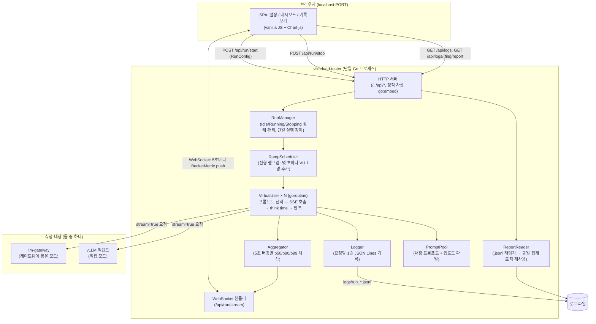
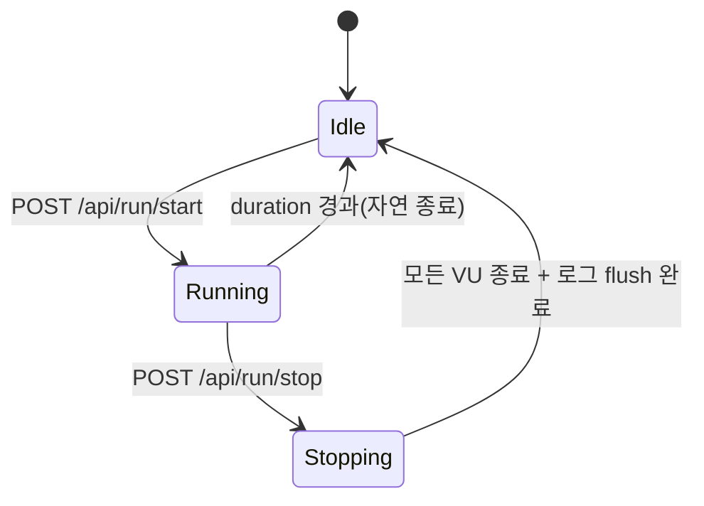
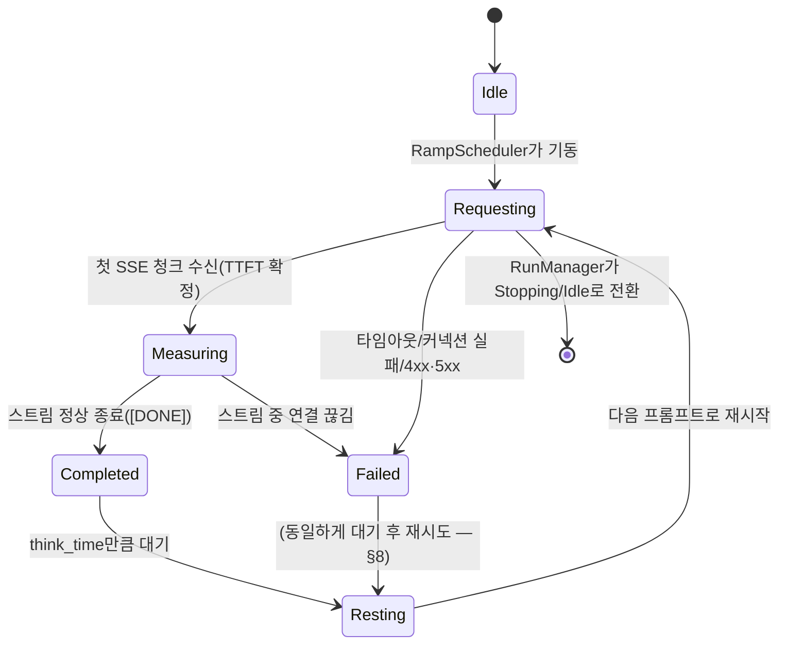
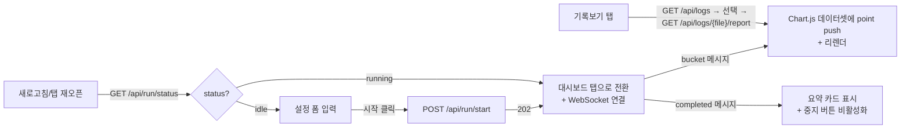

# 시스템 설계서: vllm-load-tester

## 1. 프로젝트 개요

| 항목 | 내용 |
|---|---|
| 프로젝트명 | vllm-load-tester |
| 한 줄 설명 | llm-gateway 뒤에 있는 vLLM 백엔드의 실제 추론 성능을 측정하기 위해 램프업 부하를 걸고, TTFT/TPOT/ITL 저하 지점을 실시간 그래프와 로그로 보여주는 로컬 GUI 도구 |
| 기술 스택 | Go(`net/http` + WebSocket) 백엔드, 정적 HTML/JS(Chart.js) 프론트엔드를 `go:embed`로 단일 바이너리에 내장 |
| 작성일 | 2026-09-10 |
| 기반 문서 | prd.md |

## 2. 전체 시스템 아키텍처



- 단일 프로세스, 단일 사용자 도구다. 웹 서버는 `127.0.0.1`에만 바인딩하며 외부 네트워크에 노출하지 않는다.
- `target_mode`에 따라 `VirtualUser`가 호출하는 대상만 바뀔 뿐(게이트웨이 URL vs vLLM URL), 그 외 로직(프롬프트 선택, 메트릭 계산, 로깅)은 동일한 코드 경로를 탄다 — 두 모드를 비교할 때 도구 자체의 동작 차이로 인한 왜곡이 없도록 하기 위함이다.

## 3. 데이터 모델링 (GUI 상태 + 로그 파일 — DB 없음, 구조체/스키마로 대체)

DB를 쓰지 않으므로, 프로세스 내부 상태 구조체와 로그 파일(JSON Lines) 스키마를 명세한다.

### 3.1 RunConfig (요청 바디 / 실행 설정)

| 필드 | 타입 | 제약조건 | 설명 |
|---|---|---|---|
| target_mode | string | `gateway`\|`direct` | 측정 대상 모드 |
| target_url | string | not null, URL 형식 | 게이트웨이 또는 vLLM 백엔드 URL |
| use_tls | bool | - | `https://` 사용 여부 |
| skip_tls_verify | bool | 기본 false | 자체서명 인증서 허용 |
| bearer_token | string | gateway 모드면 not null | **로그/파일에 절대 저장하지 않음** — 프로세스 메모리에서만 보관 |
| model | string | not null | 요청 body `model` 필드 |
| max_tokens | int | 기본 256, > 0 | 요청 body `max_tokens` |
| target_concurrency | int | > 0 | 램프업 목표 동시 사용자 수 |
| duration_minutes | int | > 0 | 테스트 지속 시간 |
| think_time_min_ms / think_time_max_ms | int | 0 ≤ min ≤ max | 요청 간 대기 범위 |
| request_timeout_seconds | int | 기본 60, > 0 | 개별 요청 타임아웃 |
| prompt_source | string | `builtin`\|`file` | 프롬프트 출처 |
| prompt_file_path | string | prompt_source=file일 때 필수 | 업로드된 프롬프트 파일의 서버 임시 경로 |
| log_file_path | string | 기본 `logs/run_<timestamp>.jsonl` | 결과 로그 저장 경로 |

`bearer_token`은 Go 구조체 태그에서 `json:"-"`로 마킹해 실수로도 직렬화/로그에 섞이지 않게 한다(§7).

### 3.2 RequestRecord (로그 파일의 한 줄)

```go
package model

type RequestRecord struct {
    Timestamp         time.Time `json:"ts"`
    RunID             string    `json:"run_id"`
    VUserID           int       `json:"vuser_id"`
    TargetMode        string    `json:"target_mode"`
    PromptID          string    `json:"prompt_id"`
    ConcurrencyAtSend int       `json:"concurrency_at_send"` // 요청 발사 시점의 활성 VU 수
    TTFTMs            float64   `json:"ttft_ms,omitempty"`
    TPOTMs            float64   `json:"tpot_ms,omitempty"`
    ITLMs             []float64 `json:"itl_ms,omitempty"`
    PromptTokens      int       `json:"prompt_tokens,omitempty"`
    CompletionTokens  int       `json:"completion_tokens,omitempty"`
    Status            int       `json:"status"`
    ErrorType         string    `json:"error_type,omitempty"` // timeout | connection_refused | http_4xx | http_5xx | sse_parse_error
}
```

```json
// logs/run_20260910_1400.jsonl — 한 줄 = 요청 1건
{"ts":"2026-09-10T14:00:03.120Z","run_id":"run_ab12","vuser_id":42,"target_mode":"direct","prompt_id":"p_017","concurrency_at_send":102,"ttft_ms":184.2,"tpot_ms":21.6,"itl_ms":[18,22,19,25],"prompt_tokens":36,"completion_tokens":128,"status":200}
{"ts":"2026-09-10T14:00:03.980Z","run_id":"run_ab12","vuser_id":57,"target_mode":"direct","prompt_id":"p_031","concurrency_at_send":103,"status":429,"error_type":"http_4xx"}
```

### 3.3 BucketMetric (실시간/리포트 공용 집계 단위)

```go
type Percentiles struct {
    P50 float64 `json:"p50"`
    P90 float64 `json:"p90"`
    P99 float64 `json:"p99"`
}

type BucketMetric struct {
    BucketStart    time.Time   `json:"bucket_start"`
    AvgConcurrency float64     `json:"avg_concurrency"`
    RequestCount   int         `json:"request_count"`
    ErrorCount     int         `json:"error_count"`
    TTFT           Percentiles `json:"ttft_ms"`
    TPOT           Percentiles `json:"tpot_ms"`
    ITL            Percentiles `json:"itl_ms"`
}
```

- **실시간 경로**: `Aggregator`가 5초마다 그 구간에 도착한 `RequestRecord`들로부터 `BucketMetric`을 계산해 WebSocket으로 push.
- **리포트 경로**: `ReportReader`가 `.jsonl` 파일 전체를 읽어 타임스탬프 기준으로 동일하게 5초 버킷을 나눠 **같은 집계 함수**를 재사용해 `[]BucketMetric`을 만든다. 실시간과 리포트가 다른 숫자를 보여주는 일이 없도록 집계 로직은 `internal/metrics`에 단 하나만 존재한다.
- Percentile 계산은 버킷 내 값들을 정렬 후 인덱스로 구하는 방식(요청 수가 초당 수백 건 수준이므로 별도 스트리밍 근사 알고리즘 불필요).

## 4. 핵심 API 인터페이스 명세

로컬 전용 API이므로 인증은 없다(§7에서 노출 범위로 방어). 모든 요청/응답은 `application/json`(WebSocket 제외).

### 4.1 실행 제어

#### POST /api/run/start
**설명**: 새 테스트 실행 시작
**Request Body**: `RunConfig` (§3.1)
**Response 202**: `{ "run_id": "run_ab12" }`
**에러**:
| 코드 | 설명 |
|---|---|
| 400 | 필수 필드 누락/형식 오류 (`invalid_request`) |
| 409 | 이미 실행 중인 테스트가 있음 (`run_already_in_progress`) |

#### POST /api/run/stop
**설명**: 진행 중인 테스트를 중지(진행 중 요청은 `request_timeout_seconds` 내 유예 후 종료)
**Response 200**: `{ "run_id": "run_ab12", "status": "stopping" }`
**에러**: 404 `no_active_run`

#### GET /api/run/status
**설명**: 현재 실행 상태 폴링(WebSocket 연결 전/재연결 시 초기 상태 동기화용)
**Response 200**:
```json
{
  "status": "idle | running | stopping",
  "run_id": "run_ab12",
  "elapsed_seconds": 204,
  "duration_seconds": 600,
  "current_concurrency": 102,
  "target_concurrency": 300
}
```

#### WS /api/run/stream
**설명**: 실행 중 5초마다 `BucketMetric`을 push. 연결 시 지금까지의 버킷을 모두 replay한 뒤 실시간 스트림으로 전환(새로고침해도 그래프가 끊기지 않게).
**메시지 형식**: `{"type":"bucket","data": BucketMetric}` 또는 `{"type":"completed","summary": RunSummary}`

### 4.2 프롬프트 파일 업로드

#### POST /api/prompts/upload
**설명**: `.txt`(줄바꿈 구분) 또는 `.jsonl`(`{"prompt": "..."}`) 프롬프트 파일 업로드
**Request**: `multipart/form-data`
**Response 200**: `{ "prompt_file_path": "uploads/prompts_ab12.jsonl", "prompt_count": 87 }`
**에러**: 400 `invalid_prompt_file` (빈 파일, 파싱 실패)

### 4.3 기록(리포트) 조회

#### GET /api/logs
**설명**: `logs/` 디렉터리의 `.jsonl` 파일 목록
**Response 200**: `[{ "file": "run_20260910_1400.jsonl", "started_at": "...", "size_bytes": 483920 }]`

#### GET /api/logs/{file}/report
**설명**: 로그 파일을 읽어 버킷 집계와 요약 통계를 계산해 반환
**Response 200**:
```json
{
  "buckets": [ /* BucketMetric[] */ ],
  "summary": {
    "total_requests": 5412,
    "error_rate": 0.011,
    "max_observed_concurrency": 300,
    "estimated_degradation_concurrency": 210
  }
}
```
`estimated_degradation_concurrency`는 §6에 정의한 간단한 휴리스틱으로 계산한다.
**에러**: 404 `log_file_not_found`

## 5. 폴더 구조 및 컴포넌트 분리 전략

```
vllm-load-tester/
├── cmd/
│   └── vllm-load-tester/
│       └── main.go             # 서버 기동, 기본 브라우저 자동 오픈
├── internal/
│   ├── httpapi/                # /api/* 핸들러 (run 제어, logs, prompts 업로드)
│   ├── wsapi/                  # WebSocket 핸들러 + 클라이언트 브로드캐스트
│   ├── runmanager/             # RunManager: Idle/Running/Stopping 상태, 단일 실행 강제
│   ├── ramp/                   # RampScheduler: 선형 램프업 스케줄 계산
│   ├── vuser/                  # VirtualUser: 프롬프트 선택 → SSE 호출 → think time 루프
│   ├── sseclient/               # SSE 파싱 + TTFT/ITL/TPOT 계산 (llm-gateway의 proxy 패턴 재사용)
│   ├── promptpool/               # 내장 프롬프트 세트 + 업로드 파일 파싱
│   ├── metrics/                   # 버킷 집계(Aggregator) — 실시간/리포트 공용
│   ├── logstore/                   # JSON Lines 기록(Logger) + 재읽기(ReportReader)
│   └── model/                       # RunConfig/RequestRecord/BucketMetric 등 공유 타입
├── web/                              # go:embed로 내장할 정적 프론트엔드
│   ├── index.html                   # 3탭 SPA 셸
│   ├── app.js                       # 폼 처리, WebSocket 구독, 상태 업데이트
│   ├── charts.js                    # Chart.js 래핑(TTFT/TPOT/ITL 3-라인 차트)
│   └── vendor/chart.min.js          # 오프라인 사용을 위한 로컬 번들
├── logs/                             # 실행 결과 .jsonl (.gitignore)
├── uploads/                          # 업로드된 프롬프트 파일 임시 저장 (.gitignore)
├── Makefile                          # darwin/amd64, darwin/arm64 빌드
├── go.mod / go.sum
└── README.md
```

- **도메인 기반 분리**는 llm-gateway와 동일한 원칙: `internal/`을 계층이 아니라 관심사(ramp, vuser, metrics, logstore…) 단위로 나눠 각 도메인을 독립적으로 테스트한다.
- 프론트엔드는 빌드 도구(webpack 등) 없이 순수 HTML/JS + 로컬 vendoring된 Chart.js만 사용 — Node.js 툴체인 의존성을 만들지 않는다.

## 6. 내부 상태 흐름 (상태 관리 — 프론트엔드는 프레임워크 없는 SPA이므로 상태 머신으로 대체)

### 6.1 RunManager 상태 머신 (백엔드)



- `Idle`이 아닐 때 `POST /api/run/start`가 오면 409를 반환한다(§4.1) — 도구 전체에서 활성 실행은 항상 최대 1개.

### 6.2 VirtualUser 생명주기 (VU 1개 기준)



### 6.3 프론트엔드 상태 흐름 (vanilla JS, 프레임워크 없음)



- 프론트엔드는 하나의 전역 `state` 객체(`{tab, config, buckets[], summary}`)만 두고, WebSocket 메시지·API 응답이 올 때마다 이 객체를 갱신한 뒤 그리기 함수를 호출하는 단방향 흐름을 따른다(React 등 없이도 복잡도가 낮아 충분).

## 7. 보안 설계

이 도구는 로컬 단일 사용자용이지만, llm-gateway와 마찬가지로 최소한의 위협 모델을 점검한다.

### 7.1 위협 대응 매트릭스

| 위협 | 대응 방안 | 구현 위치 |
|---|---|---|
| 도구가 외부에 노출되어 임의 사용자가 내 Bearer token/설정을 조작 | HTTP/WebSocket 서버를 `127.0.0.1`에만 바인딩(`0.0.0.0` 금지). 실수로 바인딩 주소를 바꾸는 CLI 플래그 자체를 제공하지 않는다 | `cmd/vllm-load-tester/main.go` |
| Bearer token 유출 | 메모리에만 보관(`json:"-"`), 로그/파일에 저장 금지, 프론트엔드에도 입력 필드를 `type=password`로 렌더링 | `internal/model`, `web/index.html` |
| target_url을 통한 SSRF | **의도적으로 방어하지 않음** — 이 도구의 목적 자체가 "사용자가 지정한 임의의 사내 엔드포인트를 두들기는 것"이고, 로컬 단일 사용자만 접근 가능하므로 전통적 SSRF 위협 모델(외부 공격자가 서버를 통해 내부망을 스캔)이 성립하지 않는다. README에 이 설계 의도를 명시한다 | - |
| 자체서명 TLS 인증서로 인한 MITM 위험 인지 부족 | `skip_tls_verify` 기본값 OFF, 켤 때 UI에 경고 문구 상시 노출 | `web/index.html`, `internal/httpapi` |
| 업로드된 프롬프트 파일을 통한 경로 조작(path traversal) | 업로드 파일명은 서버가 임의 생성한 이름(`uploads/prompts_<run_id>.ext`)으로 저장하고, 사용자가 보낸 원본 파일명은 저장 경로에 사용하지 않는다 | `internal/httpapi` (업로드 핸들러) |

### 7.2 민감 데이터 처리 정책

- 로그 파일(`.jsonl`)에는 `bearer_token`을 포함한 어떤 인증 정보도 남기지 않는다(§3.2 스키마에 애초에 필드 없음).
- 프론트엔드 상태나 브라우저 로컬 저장소에 토큰을 "기억"하는 기능은 선택 사항이며, 저장하더라도 브라우저 로컬 저장소(해당 브라우저 프로필 내부)를 벗어나지 않는다.

### 7.3 의존성 라이선스 검토

| 패키지 | 용도 | 라이선스 |
|---|---|---|
| github.com/gorilla/websocket | WebSocket 서버 구현 | BSD-3-Clause |
| Chart.js (vendored) | 프론트엔드 차트 렌더링 | MIT |
| (표준 라이브러리 `net/http`, `bufio`, `encoding/json`) | HTTP/SSE/직렬화 | BSD-style (Go 표준) |

GPL 계열 의존성은 사용하지 않는다.

## 8. 예외 처리 및 에러 전략

### 8.1 개별 요청 실패 분류 및 처리

| 상황 | error_type | VU 동작 |
|---|---|---|
| 연결 거부/DNS 실패 | `connection_refused` | 실패로 기록, think time 후 재시도 |
| `request_timeout_seconds` 초과 | `timeout` | 실패로 기록, think time 후 재시도 |
| HTTP 4xx (401/429 등) | `http_4xx` | 실패로 기록, think time 후 재시도(§ PRD "429 대량 발생 시" 배너와 연동) |
| HTTP 5xx | `http_5xx` | 실패로 기록, think time 후 재시도 |
| SSE 스트림 중 연결 끊김 | `sse_parse_error` | 이미 받은 청크까지의 ITL은 로그에 남기고 실패 처리 |

- 어떤 실패도 해당 VU를 영구 종료시키지 않는다 — RunManager가 Stopping/Idle로 전환할 때만 VU가 종료된다(PRD §6 "실제 부하 패턴 유지" 요구사항 그대로).

### 8.2 도구 자체의 에러

- 잘못된 `RunConfig`(§4.1 검증 실패)는 **요청을 아예 시작하지 않고** 400으로 즉시 거부한다.
- 이미 실행 중일 때 재시작 시도는 409로 거부하고 프론트엔드는 "이미 테스트가 진행 중입니다" 안내만 표시한다(중복 실행 방지, PRD §6).
- 서버 프로세스 자체의 패닉은 각 VU goroutine 단위로 `recover()`하여 해당 VU 하나만 실패로 기록하고 다른 VU와 전체 테스트에 영향을 주지 않는다.

### 8.3 저하 지점 추정 휴리스틱 (`estimated_degradation_concurrency`)

리포트 화면(§4.3)에서 "몇 명부터 느려지기 시작했는지"를 자동으로 짚어주기 위한 간단한 규칙:

```
버킷들을 avg_concurrency 오름차순으로 정렬한다.
전체 구간의 TTFT p50 중앙값(baseline)을 구한다.
avg_concurrency가 가장 낮은 것부터 훑으며,
  해당 버킷의 TTFT p50이 baseline의 1.5배를 처음 넘는 지점의 avg_concurrency를 반환한다.
그런 지점이 없으면 "저하 관찰되지 않음"으로 표시한다.
```

이 값은 참고용 추정치임을 리포트 화면에 명시한다(정밀한 변곡점 탐지 알고리즘은 이번 범위 밖).

### 8.4 재시도 정책

- 도구 자체는 실패한 개별 요청을 즉시 재시도하지 않는다 — 다음 사이클(think time 후)에 새 요청을 보내는 것이 곧 "재시도"다. 이는 실제 사용자 트래픽 패턴에 가깝고, 실패 직후 즉시 재시도하면 부하 프로파일이 왜곡되기 때문이다.

## 9. 3줄 요약 및 비유

> **3줄 요약**
> 1. 이 도구는 가상의 사용자 여러 명을 점점 늘려가며 llm-gateway(또는 vLLM에 직접) 요청을 보내고, 응답이 얼마나 빨리·매끄럽게 오는지(TTFT/TPOT/ITL)를 계속 측정합니다.
> 2. 브라우저 화면에서 실시간으로 그래프가 그려져 "몇 명부터 느려지기 시작하는지"를 눈으로 바로 확인할 수 있습니다.
> 3. 모든 측정값은 파일로 남기 때문에, 나중에 그 파일만 다시 불러와도 같은 그래프와 요약을 다시 볼 수 있습니다.
>
> **비유로 이해하기**
> 이 도구는 **놀이공원 롤러코스터의 대기줄 실험**과 비슷합니다. 안내원(도구)이 손님(가상 사용자)을 한 명씩 계속 줄에 세우면서 점점 줄을 늘려가고, 각 손님이 타는 데까지 걸린 시간(TTFT)과 타는 동안의 속도감(TPOT/ITL)을 스톱워치로 잽니다. 화면에는 "지금 줄에 몇 명 서 있을 때 대기시간이 갑자기 길어지기 시작했는지"가 실시간 그래프로 나타나고, 실험이 끝나면 모든 기록을 수첩(로그 파일)에 남겨서 나중에 다시 펼쳐 보며 "이 놀이기구(vLLM)는 몇 명까지가 적당한지"를 판단할 수 있게 해줍니다.
